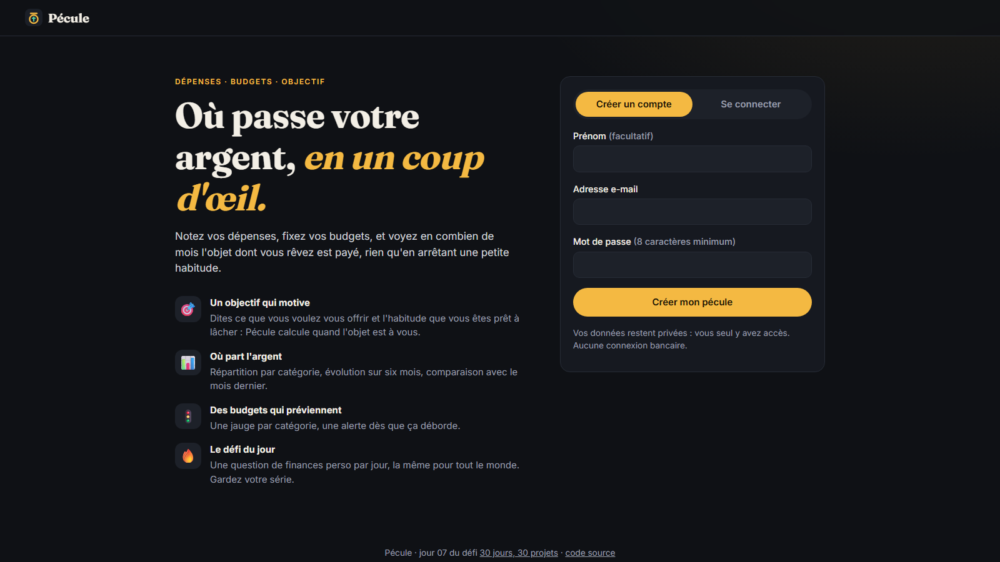

# Pécule · Où passe votre argent, en un coup d'œil

> Jour 07 du défi **30 jours, 30 projets** · React · Vite · Recharts · PocketBase · 🟢 **En ligne : [pecule.projectp.fr](https://pecule.projectp.fr)**



Pécule est un tableau de bord de dépenses personnelles. On crée son compte, on note ses dépenses, et Pécule montre où part l'argent, mois par mois et catégorie par catégorie. Il compare au mois précédent et prévient quand un budget est dépassé.

📄 Les règles détaillées sont dans le [cahier des charges](CAHIER_DES_CHARGES.md).

## Fonctionnalités

**🏠 Une page d'accueil qui explique**

- Un **simulateur** à essayer sans compte : l'objet, son prix, l'habitude à arrêter → « dans 13 mois ». L'objectif essayé pré-remplit l'inscription.
- Comment ça marche en trois étapes, le défi du jour jouable, un aperçu du tableau de bord avec des données fictives, une FAQ.

**🎯 Un objectif qui motive**

- À l'inscription : l'objet dont on rêve et son prix, puis l'habitude qu'on serait prêt à arrêter (café du matin, livraison de repas, cigarettes…) et son coût par mois.
- L'habitude se choisit parmi des idées courantes, **parmi vos propres dépenses** (moyenne des 3 derniers mois) ou dans une liste d'exemples (Netflix, forfait téléphone…).
- Pécule calcule en combien de mois l'objet est payé, et la date d'arrivée.
- On peut **ignorer l'objectif** à l'inscription : ce choix est retenu, et l'objectif reste accessible depuis le tableau de bord.
- Sur le tableau de bord : la progression, et des **accélérateurs** tirés des vraies dépenses (« en réduisant Restaurants de 30 %, 3 mois plus tôt »).

**📊 Dépenses et analyse**

- Ajout, modification et suppression d'une dépense : quoi, montant, catégorie, date.
- **Suggestions** : une centaine d'exemples courants ([`src/data/expense-examples.json`](src/data/expense-examples.json)) et vos dépenses passées ; en choisir une remplit la catégorie et le montant habituel.
- Total du mois et écart avec le mois précédent, moyenne par jour, plus grosse dépense, top 3 des catégories.
- Graphiques : répartition par catégorie, cumul du mois comparé au mois précédent, les 6 derniers mois.
- Filtres par mois et par catégorie.

**🚦 Budgets**

- Un plafond mensuel par catégorie, avec la moyenne récente pour aider à le fixer.
- Jauge verte, orange au-delà de 80 %, rouge au-delà de 100 %, et une alerte dès la dépense qui fait déborder.

**🔥 Défi du jour**

- Une question de finances perso par jour, la même pour tout le monde (tirée d'après la date, heure de Paris).
- Une seule tentative, puis l'explication ; série de jours d'affilée et taux de bonnes réponses.
- **Jouable sans compte** depuis la page d'accueil : la réponse est gardée sur l'appareil, puis rejoint le compte à l'inscription (la série continue).

## Structure

```
src/
├── lib/          Fonctions pures, testées : montants, dates, statistiques, budgets, objectif, défi, questions
├── pages/        Accueil (inscription, connexion), Objectif, Tableau de bord, Dépenses, Budgets, Défi
├── components/   Formulaire de dépense, graphiques, carte d'objectif, jauge de budget
└── api.js        Client PocketBase
pocketbase/
├── Dockerfile    Image PocketBase
└── pb_migrations Collections et règles d'accès, appliquées au démarrage
tests/            node --test, sans dépendance
```

- **Montants en centimes** (entiers) : aucune erreur d'arrondi.
- **Chacun ne voit que ses données** : chaque collection PocketBase a la règle `user = @request.auth.id`, et la création vérifie que `user` est bien l'utilisateur connecté.

## Lancer en local

PocketBase ([télécharger](https://pocketbase.io/docs/)), avec les migrations du dépôt :

```bash
./pocketbase serve --dir=pocketbase/pb_data --migrationsDir=pocketbase/pb_migrations
```

Le site, branché sur ce PocketBase local :

```bash
npm install
echo "VITE_PB_URL=http://127.0.0.1:8090" > .env.local
npm run dev                  # http://localhost:5173
npm test                     # tests unitaires
```

## Mise en ligne

Deux applications Coolify, dans le projet « Pécule » :

| Application | Adresse | Réglages |
| --- | --- | --- |
| Site | https://pecule.projectp.fr | Nixpacks, `npm run build`, dossier `dist/` publié |
| API | https://pecule-api.projectp.fr | Dockerfile de `pocketbase/`, port 8090, volume persistant sur `/pb/pb_data` |

Au premier démarrage, PocketBase affiche dans ses logs un lien d'installation pour créer le compte administrateur (tableau d'administration : `/_/`).

## Stack

React 19, Vite, Recharts, PocketBase. Polices Fraunces et Inter (Google Fonts).
